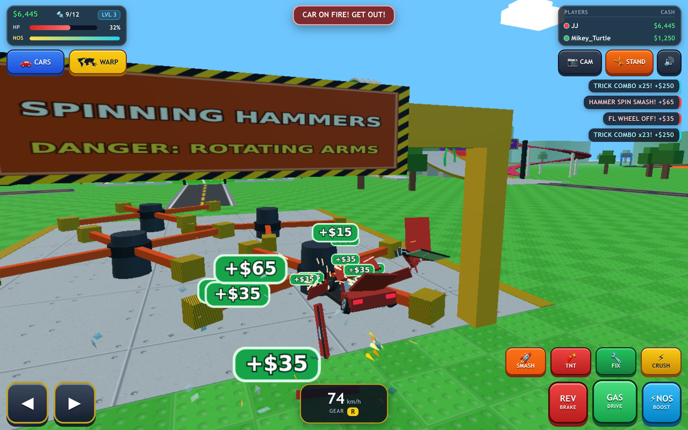

# Realistic Car Destruction (Roblox 3D Remake)

**Play Live:** [Play Live on GitHub Pages](https://kunruiw1991.github.io/roblox-car-destruction/) (https://kunruiw1991.github.io/roblox-car-destruction/)



A browser-based 3D Roblox-style car destruction sandbox built for responsive iPad Safari touch play and desktop browsers, inspired by [JJ and Mikey Realistic CAR DESTRUCTION in Roblox!](https://www.youtube.com/watch?v=Bu7U7XRSJZQ).

---

## Engine & Gameplay Highlights

- **Zero-Build Native ES2022 + Local Three.js r170**: Ships with vendored Three.js r170 (`vendor/three.module.min.js`), zero external CDNs, 100% procedural `THREE.CanvasTexture` artwork/signage, and procedural Web Audio API engine & destruction SFX (zero missing-asset 404s locally or on GitHub Pages).
- **Unified Act I & Act II 14-Zone 3D Sandbox**:
  - **Demolition Lab Hub**: Sunny green checkerboard turf, dashed ring road, central `#101` Rally Raider turntable, and shatterable glass `DEMOLITION LAB` showroom.
  - **Mechanical Crushers & Hazards**: Hydraulic Press (`CRUSHING FROM ABOVE`), Swinging Wrecking Balls gantry, Spinning Orange Hammers, Nail Hammer (`STRIKE ZONE`), Giant Hammer Drop Tower (`DROP ZONE`), Spike Drop Zone naval mines, active Railroad Crossing with moving Blue & Yellow Diesel Trains + tunnel, and Red/Green/Orange Spiked Shredder Tunnels (`EMPLOYEES ONLY`).
  - **Stunts, Arenas & Obbies**: Giant Ski Jump (`50–1500` stud distance markers), Mega Ramp + 360° Silver Loop + Cash Rings + Rainbow Wall & Spiral Ramp, Banked Multicolored-Wall Derby Arena + AI rivals & Car Football pitch, C4 Explosives / Crash Test Wall, and Lava Pit + Lava Obby Bridge (Checkmark safe lane vs. Skull catapult fork).
- **12 Modular Deformable Vehicles & 9 Paint Swatches**: Sedan, Compact, Commercial Van, Box Truck, Semi Truck, School Bus, Tuk Tuk (with 5 cockpit light bulbs), Smart Micro Car, Pickup Truck, Vintage Beetle, Monster Truck (`Mooster Truck`), and `#101` Rally Raider — each featuring `10–12+` detachable/deformable parts, progressive crumpling, fire-to-explosion states, and 9 Roblox paint swatches.
- **Blocky Avatars, Progression & Destruction Tools**: Blocky `JJ` & `Mikey_Turtle` avatars with seated steering animations and multi-limb ragdoll ejection, Cash `$` economy, Integrity `%` and Nitro `%` bars, per-car `LVL/XP` progression, live Trick/Crash Combo Scorecard, One-Tap `AUTO-SMASH`, Dynamite Bundle, and `.50 Hand Cannon`.
- **iPad Safari WebKit Compatibility Guardrails**:
  - Zero pre-RAF synchronous shader compilation (no `renderer.compile()` before the first `requestAnimationFrame`).
  - Non-IBL `MeshStandardMaterial` `metalness <= 0.20` capped and enforced across all world/vehicle spawns while `scene.environment === null`.
  - Timer-free `pointerdown` HUD touch actions with unconditional pointer `click` swallow (zero millisecond deduplication timers) plus multi-touch per-pointer hold controls for driving pedals.
  - `450 ms` modal backdrop `pointerdown` open guard to prevent accidental touch-through dismissal on Garage and Teleport modals.

---

## Controls (iPad Touch & Desktop)

| Action | iPad Touch Control | Desktop Keyboard / Mouse |
| :--- | :--- | :--- |
| **Start Game** | Tap `▶ PLAY!` | `Enter` or `Space` |
| **Steer Left / Right** | Hold `◀` / `▶` (bottom-left) | `A` / `D` or `←` / `→` |
| **Drive / Reverse & Brake** | Hold `GAS` / `REV` (bottom-right) | `W` / `S` or `↑` / `↓` |
| **Nitro Boost** | Hold `⚡NOS` (bottom-right) | `Shift` |
| **Orbit Camera** | 1-finger drag on open 3D canvas | Mouse drag on open 3D canvas |
| **One-Tap Auto-Smash** | Tap `🚀 SMASH` | `Space` |
| **Dynamite Bundle / .50 Hand Cannon** | Tap `🧨 TNT` | `E` |
| **Repair & Reset Vehicle** | Tap `🔧 FIX` | `R` |
| **Trigger Crusher / Machine** | Tap `⚡ CRUSH` (`PRESS` / `NAIL` / `DROP` / `MINES` / `TRAIN` / `BLAST`) | Tap contextual HUD button |
| **Cars / Garage & Paint Swatches** | Tap `🚗 CARS` | `G` |
| **Teleport To (14 Zones)** | Tap `🗺 WARP` | `M` |
| **Cycle Camera (Chase / Cockpit / Orbit)** | Tap `📷 CAM` | `C` |
| **Ragdoll Eject / Stand Up** | Tap `🤸 EJECT` / `STAND` | `F` |
| **Horn / Sound Toggle** | Tap `🔊` / `🔇` | `H` (horn) / Click `🔊` |
| **Close Modal** | Tap `✕` or backdrop (after `450 ms`) | `Esc` |

---

## Run Locally

Serve the repository root with any static HTTP server (no build step required):

```bash
python3 -m http.server 8080
```

Then open http://127.0.0.1:8080/ in your browser.
